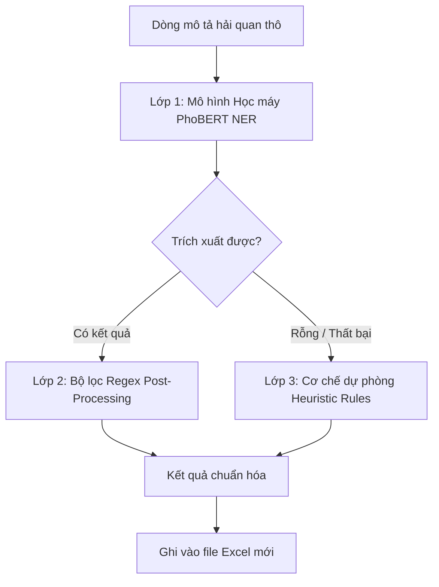

# TÀI LIỆU KỸ THUẬT: HỆ THỐNG TRÍCH XUẤT TÊN HƯƠNG LIỆU TỰ ĐỘNG
*(System Technical Documentation - Flavour Cleaner)*

---

## 1. GIỚI THIỆU BÀI TOÁN & MỤC TIÊU

### 1.1. Bài toán
Trong dữ liệu tờ khai hải quan, cột "Mô tả hàng hóa" thường được ghi dưới dạng văn bản tự do, chứa nhiều thông tin lộn xộn:
- Tên tiếng Việt và tên tiếng Anh lẫn lộn.
- Mô tả công dụng, tính chất vật lý (dạng lỏng, dạng bột, không chứa cồn).
- Quy cách đóng gói (25kg/thùng, 200L/phuy), nhà sản xuất, ngày sản xuất (NSX), hạn sử dụng (HSD).

### 1.2. Mục tiêu xử lý
Hệ thống có nhiệm vụ bóc tách chính xác tên thương mại của sản phẩm và ghi kết quả vào file Excel mới:
- **Trường hợp 1 (Có tên tiếng Anh):** Lọc bỏ toàn bộ câu tiếng Việt và thông tin quy cách, chỉ lấy tên thương mại tiếng Anh.  
  *Ví dụ:*  
  - *Đầu vào:* `Hỗn hợp hương đậu nành, nguyên liệu dùng trong công nghiệp sản xuất mì ăn liền, dạng lỏng, không chứa cồn - SOY SAUCE FLAVOUR PFE-12599, NSX: 09/07/2025; HSD: 08/07/2026`  
  - *Đầu ra:* `SOY SAUCE FLAVOUR PFE-12599`
- **Trường hợp 2 (Thuần tiếng Việt / Không có tên tiếng Anh):** Lọc bỏ phần mô tả công dụng và NSX/HSD, chỉ giữ lại tên sản phẩm tiếng Việt + mã số để không làm mất dữ liệu.  
  *Ví dụ:*  
  - *Đầu vào:* `Hương đậu nành dùng cho thực phẩm, dạng lỏng PFE-12599, NSX: 09/07/2025`  
  - *Đầu ra:* `Hương đậu nành PFE-12599`

---

## 2. KIẾN TRÚC & LUỒNG XỬ LÝ DỮ LIỆU

Hệ thống xử lý từng dòng dữ liệu theo mô hình 3 lớp nối tiếp (Cascading Pipeline):

---

### Lớp 1: Bóc tách thực thể bằng Mô hình Học máy (PhoBERT NER)

#### 1. Cơ chế gán nhãn BIO
Mô hình chia câu thành từng từ (token) và dự đoán nhãn cho từng từ theo chuẩn BIO:
- `B-PROD` (Begin Product): Từ bắt đầu tên sản phẩm.
- `I-PROD` (Inside Product): Các từ tiếp theo nằm trong tên sản phẩm.
- `O` (Outside): Các từ ngoài lề (mô tả, phụ gia, quy cách, ngày tháng).

*Ví dụ cách mô hình phân loại:*
- Chuỗi đầu vào: `Chất tạo hương SOY SAUCE FLAVOUR PFE-123 25kg`
- Kết quả gán nhãn:
  - `Chất` $\rightarrow$ `O`
  - `tạo` $\rightarrow$ `O`
  - `hương` $\rightarrow$ `O`
  - `SOY` $\rightarrow$ `B-PROD` (Bắt đầu tên sản phẩm)
  - `SAUCE` $\rightarrow$ `I-PROD` (Thuộc tên sản phẩm)
  - `FLAVOUR` $\rightarrow$ `I-PROD` (Thuộc tên sản phẩm)
  - `PFE-123` $\rightarrow$ `I-PROD` (Thuộc tên sản phẩm)
  - `25kg` $\rightarrow$ `O`
- *Kết quả ghép cụm `B-PROD` + `I-PROD`:* `SOY SAUCE FLAVOUR PFE-123`.

#### 2. Quá trình huấn luyện (Training)
- **Mô hình gốc:** Sử dụng `vinai/phobert-base` làm nền tảng vì mô hình này hiểu tốt ngữ cảnh tiếng Việt và các từ tiếng Anh đi kèm.
- **Tập dữ liệu:** Dữ liệu mô tả hải quan được gán nhãn chuẩn BIO, chia tỷ lệ 90% cho huấn luyện (Train) và 10% để đánh giá (Test).
- **Định dạng tối ưu (ONNX):** Sau khi huấn luyện, mô hình được chuyển đổi sang định dạng `ONNX` (`ml_trainer/flavour_ner_onnx/model.onnx`). Định dạng này giúp chương trình chạy trực tiếp trên CPU nhanh hơn và không cần cài đặt thư viện PyTorch nặng nề.

---

### Lớp 2: Chuẩn hóa & Gọt dữ liệu bằng Regex (Post-Processing)

Sau khi mô hình học máy trích xuất được cụm từ, dữ liệu được chuyển qua 4 bước lọc bằng biểu thức chính quy (Regex) trong file `gui_2.py`:

#### 1. Lọc thông tin quy cách, nhà sản xuất còn sót lại
- *Biểu thức:* `re.sub(r'(\bNSX\b|\bNPP\b|\bHSD\b|QUY CÁCH|DÙNG CHO|HIỆU\b|DÒNG\b).*', '', text)`
- *Ví dụ:* `APPLE FLAVOUR PFE-123 QUY CÁCH 25KG/THÙNG` $\rightarrow$ `APPLE FLAVOUR PFE-123`.

#### 2. Xóa dấu ngoặc bất đối xứng
- *Ví dụ:* `MILK FLAVOUR PFE-111(V))` $\rightarrow$ `MILK FLAVOUR PFE-111(V)`.

#### 3. Gọt tiếng Việt dính liền (Thuật toán quét ngược từ mỏ neo `FLAVOUR`/`FLAVOR`)
- *Cơ chế:* Khi mô hình học máy vô tình lấy dính chữ tiếng Việt ở đầu câu, thuật toán sẽ tìm từ khóa `FLAVOUR` (hoặc `FLAVOR`), sau đó quét lùi từng từ về trước. Nếu gặp từ có dấu tiếng Việt hoặc từ nằm trong danh sách cấm `[viet-no-diacrit]` tại `patterns.txt` (như `CAM`, `HEO`, `BO`), hệ thống sẽ cắt bỏ toàn bộ phần phía trước.
- *Ví dụ:* `Hương CAM ORANGE FLAVOUR L-9999` $\rightarrow$ Gặp từ `CAM` $\rightarrow$ Cắt bỏ `Hương CAM` $\rightarrow$ `ORANGE FLAVOUR L-9999`.

---

### Lớp 3: Cơ chế Dự phòng (Rules Fallback)

- **Khi nào kích hoạt:** Khi mô hình học máy trả về kết quả rỗng (không tìm thấy nhãn `PROD`).
- **Cơ chế hoạt động:** Gọi hàm `clean_description` trong file `clean_flavour.py`:
  1. Dùng các ký tự tiếng Việt có dấu làm ranh giới để cắt chuỗi thành các đoạn tiếng Anh riêng biệt.
  2. Chấm điểm từng đoạn:
     - Đoạn chứa từ khóa danh mục (`FLAVOUR`, `OIL`, `POWDER`...): **+10 điểm**.
     - Đoạn chứa mã sản phẩm (như `PFE-123`, `L-9999`): **+5 điểm**.
     - Điểm thưởng theo độ dài từ.
  3. Lấy đoạn văn bản đạt điểm cao nhất làm kết quả.

*Ví dụ trường hợp dự phòng:*
- *Đầu vào:* `Chất tạo hương dùng trong sản xuất: PEACH FLAVOR P-900 (Mới 100%)`
- Giả sử mô hình học máy không nhận diện được (kết quả rỗng).
- Lớp dự phòng tách chuỗi $\rightarrow$ Lấy đoạn `PEACH FLAVOR P-900` (có chữ `FLAVOR` +10đ, mã `P-900` +5đ = 15đ) $\rightarrow$ Kết quả trích xuất: `PEACH FLAVOR P-900`.

---

## 3. BẢNG TỔNG HỢP CÁC TRƯỜNG HỢP KIỂM THỬ THỰC TẾ

| STT | Loại dữ liệu | Dữ liệu đầu vào (Input) | Kết quả đầu ra (Output) | Cách thức xử lý |
| :---: | :--- | :--- | :--- | :--- |
| 1 | **Song ngữ Anh - Việt** | `Hương Bò BEEF EXTRACT POWDER PFE-123, Mới 100%` | `BEEF EXTRACT POWDER PFE-123` | Mô hình học máy nhận diện và lấy phần tiếng Anh, bỏ qua phần tiếng Việt. |
| 2 | **Thuần tiếng Việt** | `Hương cam PPE-123` | `Hương cam PPE-123` | Mô hình học máy giữ lại cụm tên tiếng Việt và mã hàng. |
| 3 | **Tiếng Việt không dấu dính liền** | `Hương CAM ORANGE FLAVOUR L-9999` | `ORANGE FLAVOUR L-9999` | Regex quét lùi từ `FLAVOUR`, phát hiện từ `CAM` trong `patterns.txt` và cắt bỏ đoạn đầu. |
| 4 | **Lặp mã đầu và cuối dòng** | `PFE-12345 - APPLE FLAVOUR PFE-12345` | `APPLE FLAVOUR PFE-12345` | Regex phát hiện mã lặp ở đầu chuỗi và tự động gọt bỏ. |
| 5 | **Thừa dấu ngoặc & quy cách** | `MILK FLAVOUR PFE-111(V)), QUY CÁCH 25KG` | `MILK FLAVOUR PFE-111(V)` | Regex cắt bỏ phần sau chữ `QUY CÁCH` và gọt dấu ngoặc `)` bị thừa. |
| 6 | **Hàng hóa ngoài ngành (Giới hạn)** | `MÁY XAY SINH TỐ CÔNG NGHIỆP MODEL-999` | Chuỗi rỗng / Không bóc tách | Dữ liệu ngoài miền huấn luyện của mô hình. |

---

## 4. HƯỚNG DẪN VẬN HÀNH & BẢO TRÌ

1. **Khởi chạy chương trình:**
   - Chạy file `Start_Flavour_Cleaner.bat` hoặc gõ lệnh `python gui_2.py` trong terminal.
2. **Cập nhật từ điển `patterns.txt`:**
   - Mục `[viet-no-diacrit]`: Chỉ thêm các từ tiếng Việt không dấu (ví dụ: `HEO`, `BO`, `GA`, `CHUOI`).
   - *Lưu ý:* Tuyệt đối không thêm các từ tiếng Anh trùng âm (như `TOM` trong Tom Yum, `VAN` trong Vanilla) vì sẽ làm cắt cụt tên sản phẩm tiếng Anh.
3. **Huấn luyện lại mô hình (khi có thêm dữ liệu):**
   - Giữ nguyên cấu trúc nhãn `PROD` (`B-PROD`, `I-PROD`) để đảm bảo code trong `gui_2.py` nhận diện chính xác.

---

## 5. HIỆU NĂNG, BẢO MẬT & KHẢ NĂNG CHỊU TẢI

1. **Bảo mật dữ liệu tuyệt đối (100% Offline):**
   - Hệ thống và mô hình học máy được đóng gói chạy hoàn toàn nội bộ (local) trên máy tính cá nhân.
   - Không có bất kỳ dữ liệu tờ khai hải quan nào bị gửi lên mạng hay thông qua API bên ngoài, đảm bảo an toàn thông tin tuyệt đối cho doanh nghiệp.

2. **Hiệu năng & Tốc độ xử lý:**
   - Nhờ việc chuyển đổi mô hình sang định dạng ONNX, hệ thống không đòi hỏi máy tính phải có card đồ họa (GPU).
   - Tốc độ thực tế trên CPU phổ thông: Xử lý mượt mà **800 dòng dữ liệu chỉ mất khoảng 24 giây** (tương đương ~33 dòng/giây).

3. **Khả năng chịu tải trên dữ liệu lớn (10.000+ dòng):**
   - Thuật toán bóc tách xử lý từng dòng hoàn toàn độc lập và giải phóng bộ nhớ ngay lập tức.
   - Khi xử lý các file dữ liệu rất lớn (hàng chục ngàn dòng), hệ thống không bị quá tải RAM và độ chính xác của AI không hề bị suy giảm so với các file nhỏ.
